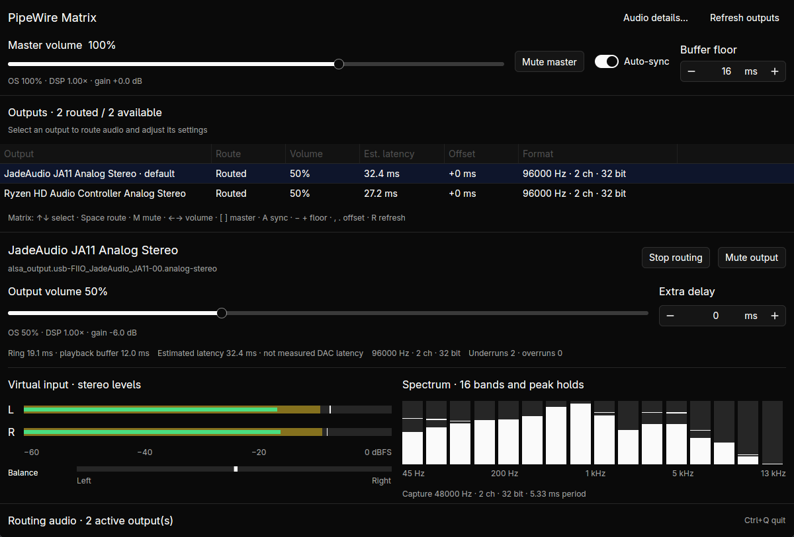
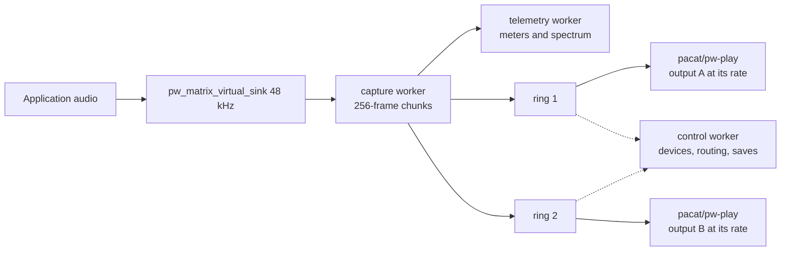

# pw-matrix-router

A PipeWire audio router and multi-output splitter for Linux. One stereo input is captured at 48 kHz and rendered to every enabled output at that output's own sample rate, with a Rust DSP path and a native GPUI desktop window.

[](https://github.com/MasFana/pw-matrix-router/actions/workflows/ci.yml)
[](LICENSE)
[](rust-toolchain.toml)



## What it does

- Creates a virtual sink named `pw_matrix_virtual_sink` and captures it as 48 kHz stereo float.
- Copies the captured stream to each routed output, streaming through a separate single-producer, single-consumer ring per output.
- Resamples to each output's rate with a 128-tap windowed-sinc filter, so a 44.1 kHz DAC and a 48 kHz DAC can play the same source together.
- Provides per-output volume, mute, and extra delay, plus an auto-sync toggle that aligns estimated queue delays.
- Shows a live output table, stereo meters with peak hold, a 16-band spectrum, and a balance bar.
- Persists volume, routing, delay, and the buffer floor in `~/.config/pw-matrix/config.json`.
- Becomes the default sink on start and moves existing playback streams to the hub, then restores the previous default sink on a clean exit. Only modules it created are removed.

## Requirements

- Linux with PipeWire and the PulseAudio compatibility tools: `pactl`, `parec`, `pacat`. The router falls back to `pw-record` and `pw-play` when the `parec` or `pacat` wrappers are missing.
- A desktop session with X11 or Wayland, since the window uses GPUI.
- The pinned Rust toolchain, `nightly-2026-11-18`. `rust-toolchain.toml` installs it automatically when you build with rustup.

Runtime packages on Debian or Ubuntu:

```sh
sudo apt install pipewire pipewire-pulse pulseaudio-utils libxkbcommon-x11-0 libxcb-xkb1
```

Build packages:

```sh
sudo apt install build-essential pkg-config libfontconfig1-dev libfreetype-dev \
  libxkbcommon-dev libxcb1-dev libxcb-render0-dev libxcb-shape0-dev \
  libxcb-xfixes0-dev libvulkan-dev
```

## Build and run

```sh
git clone https://github.com/MasFana/pw-matrix-router.git
cd pw-matrix-router
cargo run --release --locked
```

The release profile uses thin LTO with one codegen unit, so the first optimized build takes a few minutes.

To install the binary:

```sh
cargo install --path . --locked
```

## First run

1. Start the router. It creates the virtual sink, makes it the default sink, moves existing playback streams to it, and lists every output it can see.
2. Select an output row with the pointer or the arrow keys.
3. Press Space, or use **Route audio**, to send the virtual sink stream to that output.
4. Play audio to the `pw_matrix_virtual_sink` device, then set per-output volume and delay in the panel below the table.

Quit through Ctrl+Q or a window close so the previous default sink is restored. If the process is killed with SIGKILL, the hub module and the default change stay behind; remove them with `pactl` yourself.

If a sink named `pw_matrix_virtual_sink` already exists, the router refuses to start and changes nothing. Stop the process that owns it first. The router never unloads modules it did not create.

## Keyboard

Keys apply while the output table has focus.

| Key | Action |
| --- | --- |
| Up, `k` / Down, `j` | Move selection |
| Space, Enter | Route or unroute the selected output |
| `m` | Mute the selected output |
| Shift+M | Mute the master output |
| Left, `h` / Right, `l` | Adjust output volume |
| `[` / `]` | Adjust master volume |
| `-` / `=` | Decrease or increase the buffer floor |
| `,` / `.` | Decrease or increase extra delay |
| `a` | Toggle auto-sync |
| `r` | Refresh the device list |
| `q`, Ctrl+C | Quit |
| Ctrl+Q | Quit from anywhere |

## How it works



Each output owns a ring, and only its consumer advances the read cursor. Capture discards the newest excess frames on overload rather than overwriting unread audio. Rendering runs on the output worker for that device. See [docs/ARCHITECTURE.md](docs/ARCHITECTURE.md) for the thread model, latency accounting, and filter details.

## Measured behavior

These numbers come from the development machine and a single run per measurement. Treat them as evidence that the DSP path works, not as a speed guarantee for your hardware.

| Measurement | Result |
| --- | --- |
| 23 kHz tone, 48 kHz to 44.1 kHz, output level | -96.6 dB relative to the input tone |
| Same test with the previous cubic interpolator | -3.1 dB |
| Transport plus resampling, 44.1 kHz output | 115.7 ns per output frame |
| Added filter delay | 63 source frames, 1.31 ms at 48 kHz |
| Stereo RMS, isolated 48 kHz sink | 0.141420 left, 0.070711 right for 0.2/0.1 amplitude tones |
| Stereo RMS, isolated 44.1 kHz sink | 0.141422 left, 0.070710 right for the same tones |
| Library tests | 70 passing |

The same isolated run recorded one 48 kHz ring underrun and none at 44.1 kHz. Buffers were left unchanged.

## Limitations

- This is soft real-time software. It asks the OS for scheduling priority but does not guarantee it, does not lock memory, and does not claim hard real-time behavior.
- The 12 ms playback buffer is a requested estimate. It is not a measured DAC latency, and the app labels it that way.
- Auto-sync aligns estimated queue delays. It does not measure physical output latency or phase between devices.
- Correlation shown by earlier builds was removed. Balance remains, and it describes the stereo image of the hub signal.
- One instance per machine. The fixed hub name means a second instance refuses to start.
- Linux only. The Windows WASAPI router this project started from is a separate Go program: [MasFana/wasapi-router-go](https://github.com/MasFana/wasapi-router-go).

## Development

```sh
cargo test --lib --locked
cargo fmt --check
cargo clippy --all-targets --locked
```

Isolated audio testing, profiling notes, and the steps for a manual smoke test are in [docs/DEVELOPING.md](docs/DEVELOPING.md). Release steps are in [docs/RELEASING.md](docs/RELEASING.md).

## Project layout

| Path | Contents |
| --- | --- |
| `src/audio` | Engine, capture, per-output render workers, device discovery |
| `src/dsp` | Ring buffers, windowed-sinc resampling, limiter, volume, telemetry |
| `src/config` | Config schema, XDG paths, JSON import, atomic saves |
| `src/ui` | GPUI window, table, controls, keyboard actions |
| `src/components` | Meter, spectrum, and balance drawing |
| `src/platform` | Subprocess helpers and process priority |

## Contributing

Issues and pull requests are welcome. Read [CONTRIBUTING.md](CONTRIBUTING.md) and [CODE_OF_CONDUCT.md](CODE_OF_CONDUCT.md) before opening a pull request. Security reports go through [SECURITY.md](SECURITY.md), not the public issue tracker.

## License

MIT. See [LICENSE](LICENSE).

The project began as a Rust port of the Linux path in [wasapi-router-go](https://github.com/MasFana/wasapi-router-go). The resampling and limiter design references Julius O. Smith's resampling work, Putnam and Smith's fractional-delay filter paper, and the Giannoulis, Massberg, and Reiss compressor tutorial. Links are in [docs/ARCHITECTURE.md](docs/ARCHITECTURE.md#references).